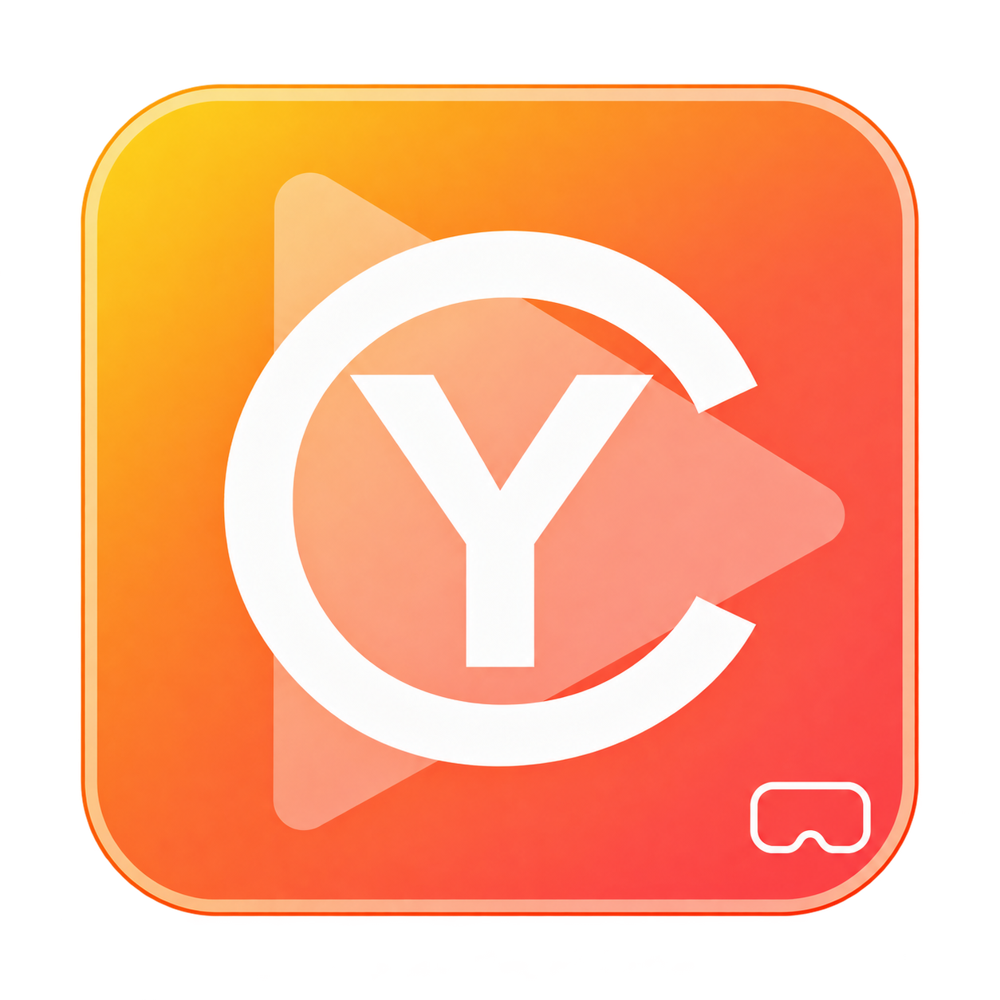
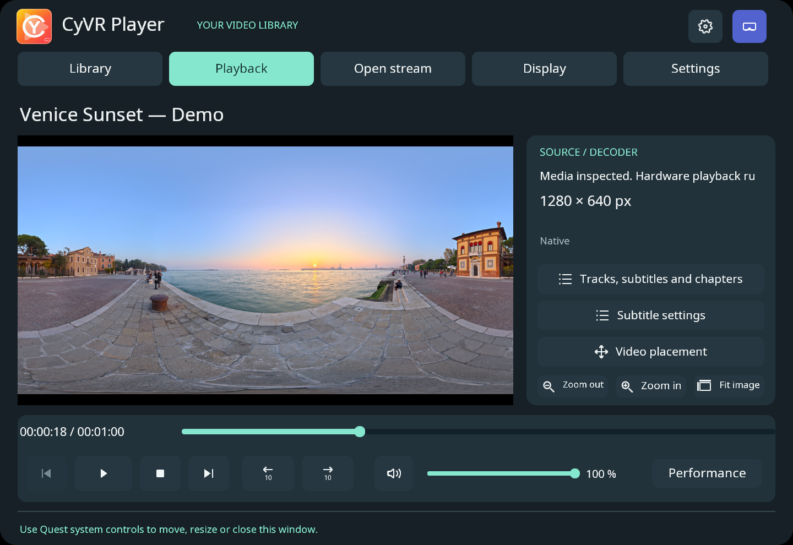
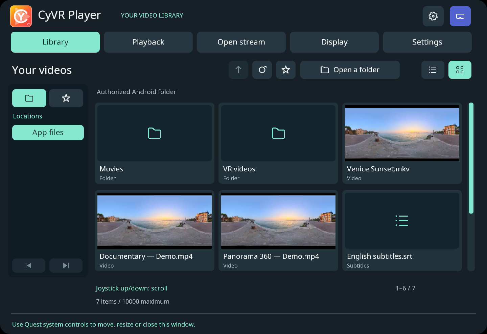
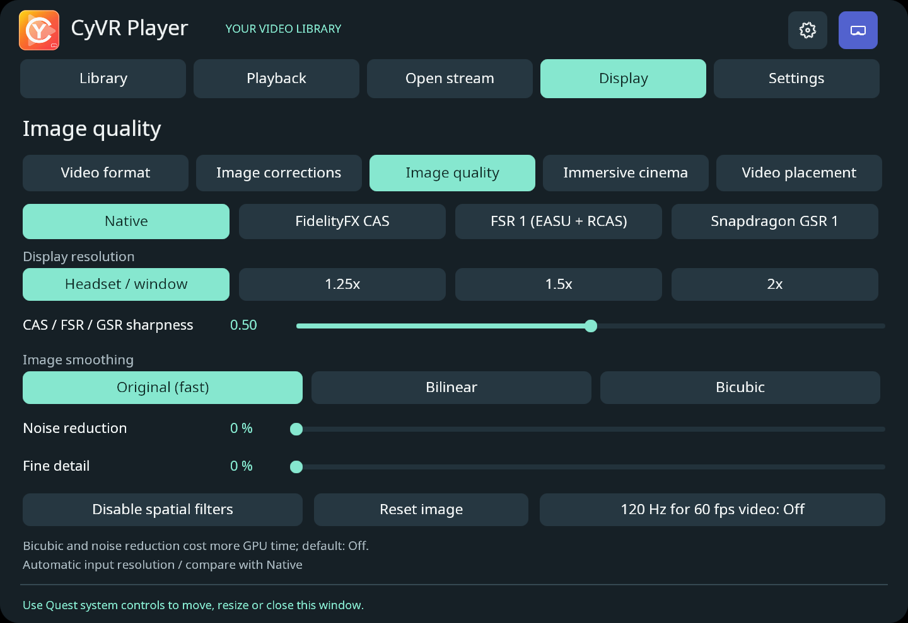
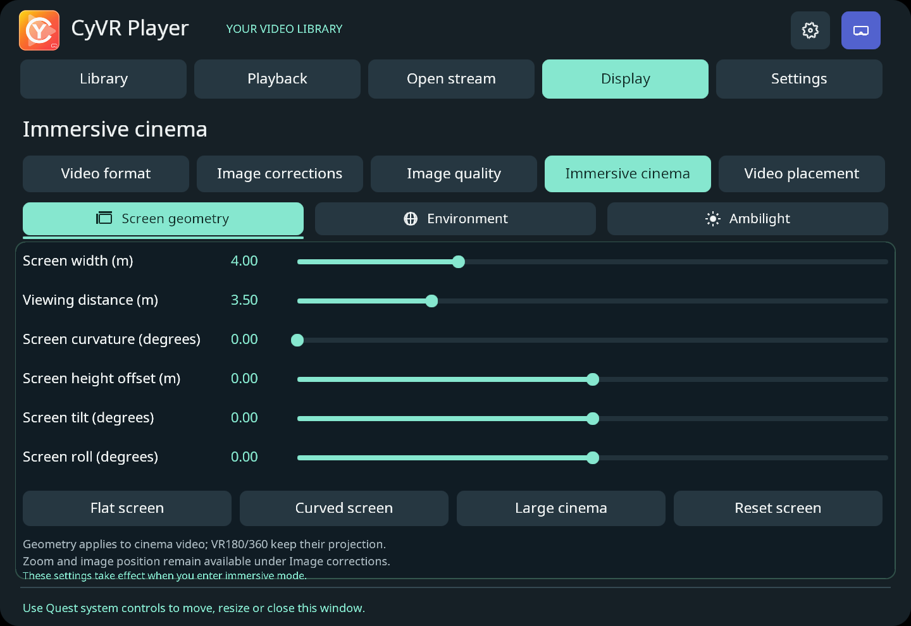
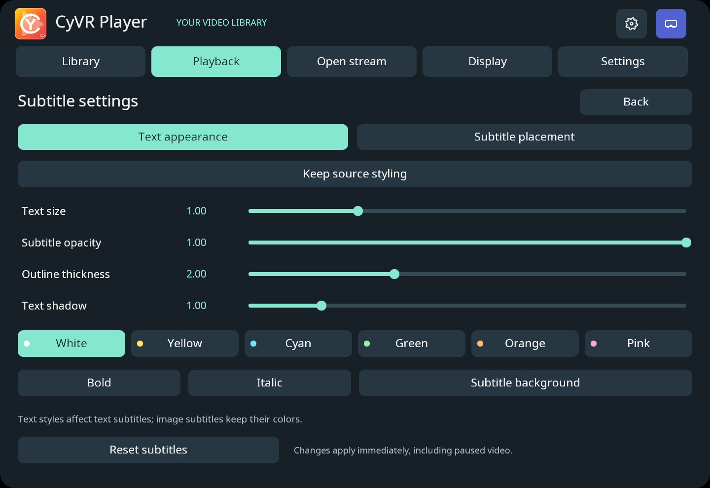
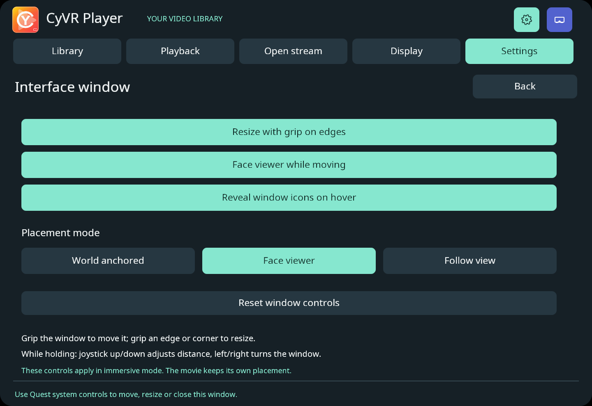
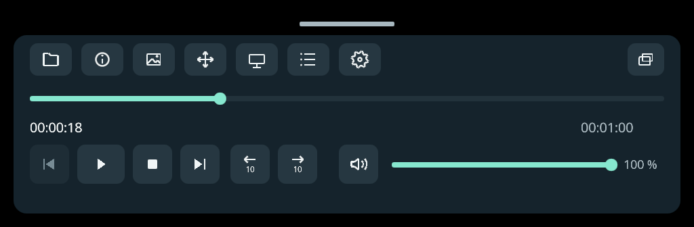

<table width="100%">
  <tr>
    <td width="300" align="left" valign="top">
      <a href="docs/user-guide.md">Guide utilisateur (anglais)</a><br>
      <a href="https://github.com/MrMybal/CyVR_Player">Dépôt</a><br><br>
      <sub>README</sub><br>
      <a href="README.md">English</a> · <a href="README.fr.md">Français</a>
    </td>
    <td width="400" align="center" valign="middle">
      
    </td>
    <td width="300" align="right" valign="top">
      <p><sub>Licence de l’application</sub><br><a href="LICENSE"><strong>GPL-3.0-only</strong></a></p>
      <p><sub>Version</sub><br><a href="docs/releases/0.4.15-beta.1.fr.md"><strong>0.4.15-beta.1</strong></a><br><strong>BÊTA</strong></p>
      <p><a href="https://github.com/MrMybal/CyVR_Player/releases/download/v0.4.15-beta.1/CyVR_Player-0.4.15-beta.1-arm64.apk"><strong>Télécharger</strong></a><br><sub>Meta Quest · Android ARM64</sub></p>
    </td>
  </tr>
</table>

<h1 align="center">CyVR Player</h1>

Un lecteur vidéo natif **C++17 / Vulkan pour Meta Quest**, destiné aux fichiers locaux, flux réseau, films 3D et vidéos VR180/360. Il s’ouvre dans une véritable fenêtre Android 2D et propose un mode immersif optionnel.

> **BÊTA · 0.4.15-beta.1**
>
> Version en cours de validation avant une disponibilité stable. La compatibilité dépend du fichier et du casque ; consulter les limites documentées et signaler les problèmes rencontrés. Consulter les [notes de version et problèmes connus](docs/releases/0.4.15-beta.1.fr.md).

[](docs/images/playback.png)

## À propos de CyVR Player

Ouvrir un dossier Android autorisé, parcourir les vidéos en liste ou en tuiles, ou saisir l’adresse d’un flux HTTP(S), HLS ou RTSP. La page Lecture réunit timeline, volume et choix des pistes audio, vidéo et sous-titres.

En immersion, placer le film indépendamment des commandes, courber l’écran de cinéma, choisir un fond ou activer l’Ambilight. La mini barre disparaît après trois secondes sans interaction ; une pression volontaire la réaffiche. La grande fenêtre reste visible pendant les réglages. L’interface partagée repose sur **CyVR_UI 0.9.1**, sous MIT ; l’anglais est la langue par défaut et le français est disponible dans les réglages.

| Bibliothèque et aperçus | Qualité d’image en temps réel |
| :---: | :---: |
| [](docs/images/library.png) | [](docs/images/image-quality.png) |
| **Géométrie du cinéma** | **Apparence des sous-titres** |
| [](docs/images/cinema.png) | [](docs/images/subtitles.png) |
| **Fenêtre de l’interface** | **Commandes immersives compactes** |
| [](docs/images/window-controls.png) | [](docs/images/compact-controls.png) |

Les captures montrent l’interface C++/Vulkan partagée dans l’inspecteur Windows, en anglais et avec un média de démonstration. La mini barre immersive est présentée séparément de la scène du casque. Voir les [détails des captures et crédits](docs/images/README.md) en anglais.

## Fonctionnalités

- **Formats vidéo** : image plane, stéréo SBS/haut-bas et VR180/360 équirectangulaire ; détection automatique optionnelle, réglable manuellement.
- **Sources** : fichiers, images DVD/Blu-ray accessibles en lecture aléatoire, HTTP(S), HLS et RTSP. Le choix des pistes et chapitres dépend de la source.
- **Image** : modes natif, CAS, FSR 1 et GSR 1, lissage, réduction du bruit, détails, corrections de couleur et zoom.
- **Placement immersif** : prise et rotation indépendantes du film, déplacement/redimensionnement des fenêtres au grip et commandes de lecture compactes.
- **Sous-titres** : pistes texte et bitmap prises en charge, fichiers externes, apparence et placement dans l’espace.
- **Scènes Gaussian** : Gaussian PLY, `.splat` et séquences au format interne `.splatseq`.

Le décodage matériel est utilisé lorsqu’il est disponible, avec un secours logiciel. Les codecs pris en charge, exclusions des disques protégés, conversions HDR vers SDR et limites de performance sont détaillés dans le [guide utilisateur en anglais](docs/user-guide.md). La lecture de tous les formats et des hautes résolutions soutenues ne sont pas garanties.

---

## Installation

L’APK publié cible **Meta Quest sous Android ARM64**, avec Android API 32 minimum et Horizon OS v69 ou ultérieur pour les transitions entre 2D et immersion. Le manifeste cible Quest 2, Quest 3S, Quest 3 et Quest Pro ; les vérifications sur casque ont été réalisées sur Quest 3. L’inspecteur Windows est un outil de développement compilable depuis les sources ; aucun exécutable Windows n’accompagne cette release.

1. [Télécharger l’application publiée](https://github.com/MrMybal/CyVR_Player/releases/download/v0.4.15-beta.1/CyVR_Player-0.4.15-beta.1-arm64.apk).
2. Installer l’APK avec votre outil de sideload habituel ou `adb install -r CyVR_Player-0.4.15-beta.1-arm64.apk`. Une mise à jour signée avec la même identité conserve les données et autorisations.
3. Lancer **CyVR Player** depuis Home ou Overlay. Utiliser **Open a folder** pour autoriser un dossier, ou **Open stream** pour un flux. **Enter immersive** ouvre le mode VR ; **Return to 2D** revient à la fenêtre Android.

## Sources, compilation et bibliothèques nécessaires

<details>
<summary>Compiler depuis les sources</summary>

### Prérequis

- Windows, Python 3.11+ avec Pillow, JDK et SDK Android : NDK 27.2.12479018, CMake 3.22.1, Build Tools 35.0.1 et plateforme 34 ; Git for Windows et 7-Zip pour préparer les dépendances. LLVM et le SDK Windows sont nécessaires aux outils natifs de compilation. NumPy est optionnel pour régénérer les ressources gant/PBR du socle.
- [CyVR_UI 0.9.1](https://github.com/MrMybal/CyVR_UI) — socle C++/Vulkan requis, placé à côté de `CyVR_Player` ; les dépendances média sont figées dans `dependencies.lock.json`.

### Récupérer les sources

```sh
git clone https://github.com/MrMybal/CyVR_Player.git
git clone https://github.com/MrMybal/CyVR_UI.git
cd CyVR_Player
```

### Compiler et lancer

```sh
python tools/prepare_android_media.py
python tools/prepare_splats.py
python tools/build_codecs.py
python tools/build_subtitles.py --target android
python tools/build_discs.py --target android
python tools/build_ffmpeg_android.py --alpha
python tools/build_app.py --target android --beta
python tools/verify_app.py --beta
```

Ces commandes supposent le SDK, le chargeur OpenXR du socle et une clé de signature locale déjà préparés. Le profil média optimisé nommé `--alpha` est partagé par les paquets Alpha et Beta. Consulter le [guide de compilation](docs/building.md) et le fichier `SOURCE_BUILD.md` de l’[archive des sources de la Beta](https://github.com/MrMybal/CyVR_Player/releases/download/v0.4.15-beta.1/CyVR_Player-0.4.15-beta.1-sources.zip) pour la préparation complète. Le socle exact fourni dans l’archive permet de reconstruire cette version. `--no-immersive` crée une variante exclusivement 2D ; elle utilise le même paquet Android et remplace l’autre variante.

</details>

---

## Licence

**CyVR Player est sous [GPL-3.0-only](LICENSE).** Copyright © 2026 MrMybal. Le code, les shaders, scripts et documents originaux relèvent de cette licence, sauf indication contraire dans un fichier. Les composants tiers conservent leurs propres licences.

L’utilisation commerciale est permise dans le respect des conditions applicables. La redistribution doit notamment respecter les obligations de fourniture des sources correspondantes. Voir [LICENSE](LICENSE) et [NOTICE](NOTICE).

### Bibliothèques tierces

| Bibliothèque · sources | Licence · texte | Utilisation / périmètre |
| --- | --- | --- |
| [CyVR_UI 0.9.1](https://github.com/MrMybal/CyVR_UI) | [MIT](https://github.com/MrMybal/CyVR_UI/blob/main/LICENSE) | Interface native et rendu Vulkan partagés ; hôte OpenXR utilisé uniquement en immersion. |
| [FFmpeg](https://github.com/FFmpeg/FFmpeg) | [LGPL-3.0-or-later](https://github.com/FFmpeg/FFmpeg/blob/611cec792aa54e2e53dbc1be95dcf5955d9a99ba/COPYING.LGPLv3) | Démultiplexage, codecs logiciels, conversion audio et sous-titres à l’exécution ; le profil Android de bibliothèques partagées désactive les composants GPL/nonfree. |
| [Mbed TLS 3.6.7](https://github.com/Mbed-TLS/mbedtls) | [Apache-2.0](https://github.com/Mbed-TLS/mbedtls/blob/mbedtls-3.6.7/LICENSE) | Option Apache de la double licence amont ; TLS pour la lecture réseau de FFmpeg. |
| [OpenXR SDK / loader 1.1.49](https://github.com/KhronosGroup/OpenXR-SDK) | [Apache-2.0 et notices des composants](https://github.com/MrMybal/CyVR_UI/blob/main/THIRD_PARTY.md) | Chargeur du runtime immersif optionnel ; certains fichiers proposent aussi MIT. Exclu de l’APK exclusivement 2D. |
| [Vulkan Headers](https://github.com/KhronosGroup/Vulkan-Headers) | [Apache-2.0 / MIT selon le fichier](https://github.com/MrMybal/CyVR_UI/blob/main/THIRD_PARTY.md) | En-têtes d’API, avec l’option Apache retenue ici ; le pilote est fourni par le casque. |
| [Android NDK support](https://developer.android.com/ndk) | [Apache-2.0; Apache-2.0 WITH LLVM-exception](https://github.com/MrMybal/CyVR_UI/blob/main/THIRD_PARTY.md) | Support NativeActivity et runtime/support C++ LLVM, selon les notices des différents composants du NDK. |
| [FidelityFX CAS](https://github.com/GPUOpen-Effects/FidelityFX-CAS) | [MIT](third_party/cas/LICENSE.txt) | Netteté GPU optionnelle. |
| [FidelityFX FSR 1](https://github.com/GPUOpen-Effects/FidelityFX-FSR) | [MIT](third_party/fsr1/LICENSE.txt) | Reconstruction spatiale EASU + RCAS optionnelle. |
| [Snapdragon GSR 1](https://github.com/SnapdragonGameStudios/snapdragon-gsr) | [BSD-3-Clause](third_party/gsr1/LICENSE) | Reconstruction spatiale mobile optionnelle. |
| [dav1d 1.5.4](https://www.videolan.org/projects/dav1d.html) | [BSD-2-Clause](https://code.videolan.org/videolan/dav1d/-/blob/1.5.4/COPYING) | Secours AV1 logiciel lorsque le décodage matériel est indisponible. |
| [edge264-mvc](https://github.com/jens-duttke/edge264-mvc) | [BSD-3-Clause](https://github.com/jens-duttke/edge264-mvc/blob/4555276ce692ee8abdb8f768d4e59f82b1f6590e/LICENSE_BSD.txt) | Décodage stéréoscopique MVC logiciel. |
| [libass 0.17.4](https://github.com/libass/libass) | [ISC](https://github.com/libass/libass/blob/0.17.4/COPYING) | Rendu ASS/SSA et sous-titres texte à l’exécution. |
| [FreeType 2.14.1](https://github.com/freetype/freetype) | [FTL](https://github.com/freetype/freetype/blob/VER-2-14-1/docs/FTL.TXT) | Rastérisation des polices ; option FreeType License retenue. |
| [HarfBuzz 11.2.1](https://github.com/harfbuzz/harfbuzz) | [MIT](https://github.com/harfbuzz/harfbuzz/blob/11.2.1/COPYING) | Mise en forme des caractères des sous-titres. |
| [FriBidi 1.0.16](https://github.com/fribidi/fribidi) | [LGPL-2.1-or-later](https://github.com/fribidi/fribidi/blob/v1.0.16/COPYING) | Texte bidirectionnel des sous-titres. |
| [SplatKit](https://github.com/Xget7/splatkit) | [MIT et notices des composants](https://github.com/Xget7/splatkit/blob/e67526e2ae1b64d474275208639c1a1015c843b8/LICENSE) | Sous-ensemble Vulkan pour la visibilité, le tri et le rendu des Gaussian Splats. |
| [VulkanMemoryAllocator 3.2.1](https://github.com/GPUOpen-LibrariesAndSDKs/VulkanMemoryAllocator) | [MIT](https://github.com/GPUOpen-LibrariesAndSDKs/VulkanMemoryAllocator/blob/v3.2.1/LICENSE.txt) | Allocation de mémoire GPU du moteur Gaussian. |
| [libbluray 1.5.0](https://www.videolan.org/developers/libbluray.html) | [LGPL-2.1-or-later](https://code.videolan.org/videolan/libbluray/-/blob/1.5.0/COPYING) | Lecture des titres et playlists Blu-ray des images prises en charge. |
| [libudfread 1.2.0](https://code.videolan.org/videolan/libudfread) | [LGPL-2.1-or-later](https://code.videolan.org/videolan/libudfread/-/blob/1.2.0/COPYING) | Accès UDF aux images de disque. |
| [libdvdread 7.1.1](https://code.videolan.org/videolan/libdvdread) | [GPL-2.0-or-later](https://code.videolan.org/videolan/libdvdread/-/blob/7.1.1/COPYING) | Lecture des structures et données DVD-Video. |
| [Noto Sans](https://github.com/notofonts/noto-fonts) | [SIL OFL 1.1](https://github.com/notofonts/noto-fonts/blob/v20201206-phase3/LICENSE) | Police d’interface/sous-titres embarquée et atlas d’interface dérivé. |
| [stb_image](https://github.com/nothings/stb) | [MIT](https://github.com/nothings/stb/blob/013ac3beddff3dbffafd5177e7972067cd2b5083/LICENSE) | Décodage des fonds JPEG ; option MIT parmi les alternatives MIT/domaine public. |
| [Photographies de décors Poly Haven](https://github.com/MrMybal/CyVR_UI/blob/main/assets/scenes/README.md) | [CC0-1.0](https://github.com/MrMybal/CyVR_UI/blob/main/third_party/notices/CC0-1.0.txt) | Photographies de cinéma embarquées et image de démonstration, créditées à Greg Zaal. |
| [GNU make 4.4.1](https://github.com/mirror/make) | [GPL-3.0-or-later](https://github.com/mirror/make/blob/4.4.1/COPYING) | Outil de compilation uniquement ; ni lié au lecteur ni livré avec lui. |
| [Pillow](https://github.com/python-pillow/Pillow) | [MIT-CMU](https://github.com/python-pillow/Pillow/blob/main/LICENSE) | Préparation des images, polices et icônes à la compilation uniquement. |
| [NumPy](https://github.com/numpy/numpy) | [BSD-3-Clause et notices des composants](https://github.com/numpy/numpy/blob/main/LICENSE.txt) | Génération optionnelle des ressources gant/PBR pendant la création ; absent du runtime de l’application. |

Ce tableau indexe les principaux composants ; il ne remplace pas les notices complètes livrées dans `assets/licenses`. Les versions et empreintes sont enregistrées dans [dependencies.lock.json](dependencies.lock.json). Les dépendances du chargeur OpenXR et du runtime C++, les polices et les ressources conservent leurs notices spécifiques. Les API Android, décodeurs matériels, runtime Quest et pilotes sont fournis par la plateforme.

Pour le périmètre du socle, voir les [notices CyVR_UI](https://github.com/MrMybal/CyVR_UI/blob/main/THIRD_PARTY.md). Les archives de sources des dépendances accompagnent la Beta.

## Références et liens

- [Guide utilisateur détaillé (anglais)](docs/user-guide.md).
- [Notes de version et limites connues](docs/releases/0.4.15-beta.1.fr.md).
- [Releases et téléchargements](https://github.com/MrMybal/CyVR_Player/releases/tag/v0.4.15-beta.1) · [Dépôt des sources](https://github.com/MrMybal/CyVR_Player) · [Signaler un problème](https://github.com/MrMybal/CyVR_Player/issues).
- [Guide de compilation (anglais)](docs/building.md) · [Architecture et intégration (anglais)](docs/interface.md).
- [Crédits des captures (anglais)](docs/images/README.md) · [CyVR_UI](https://github.com/MrMybal/CyVR_UI).
