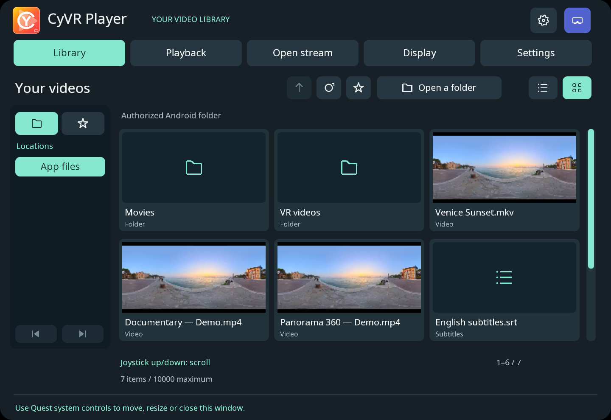
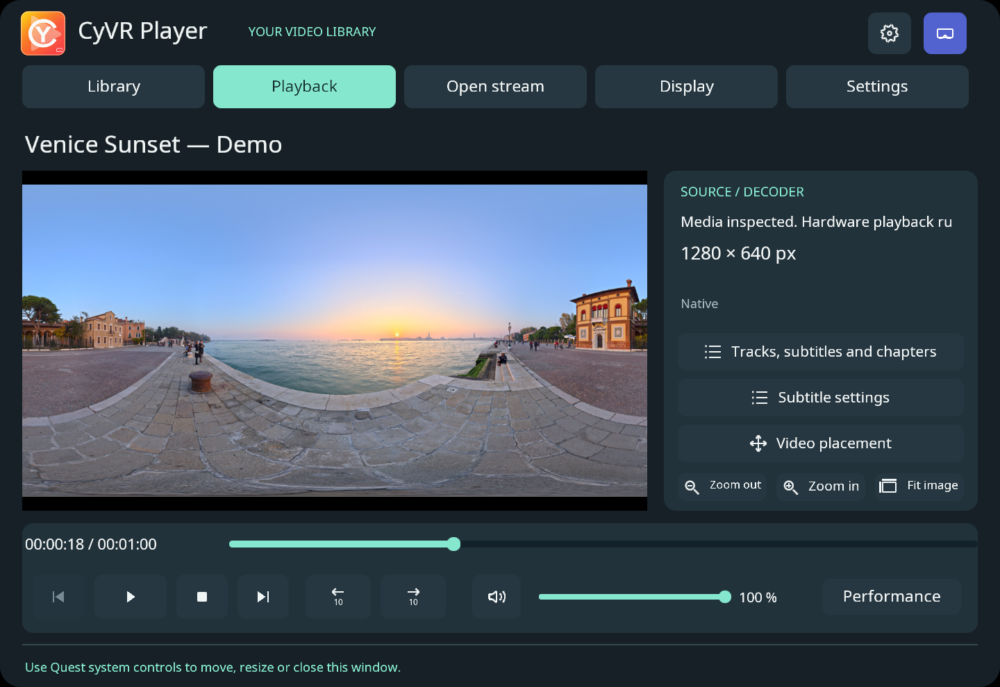
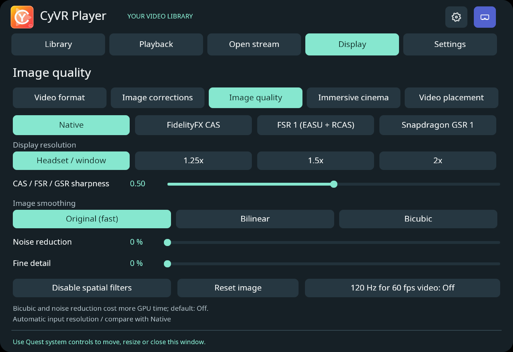
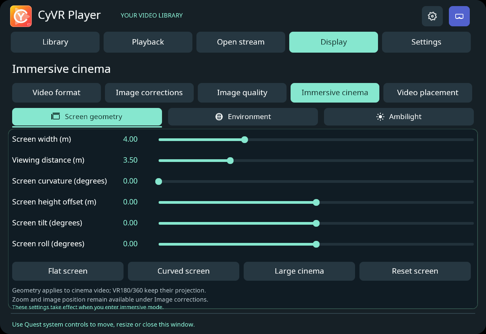
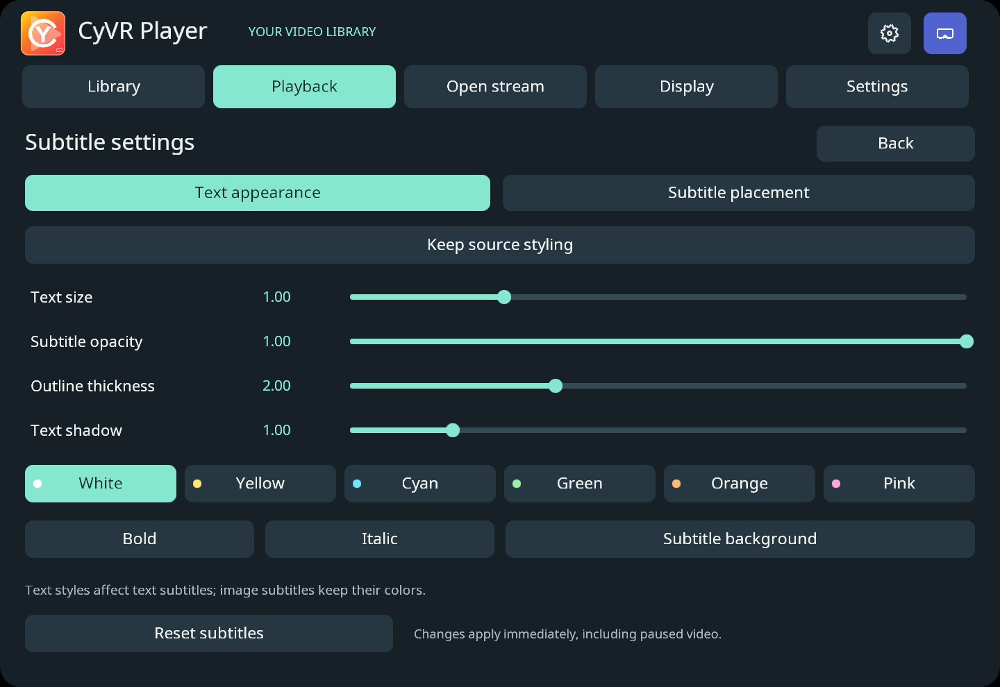
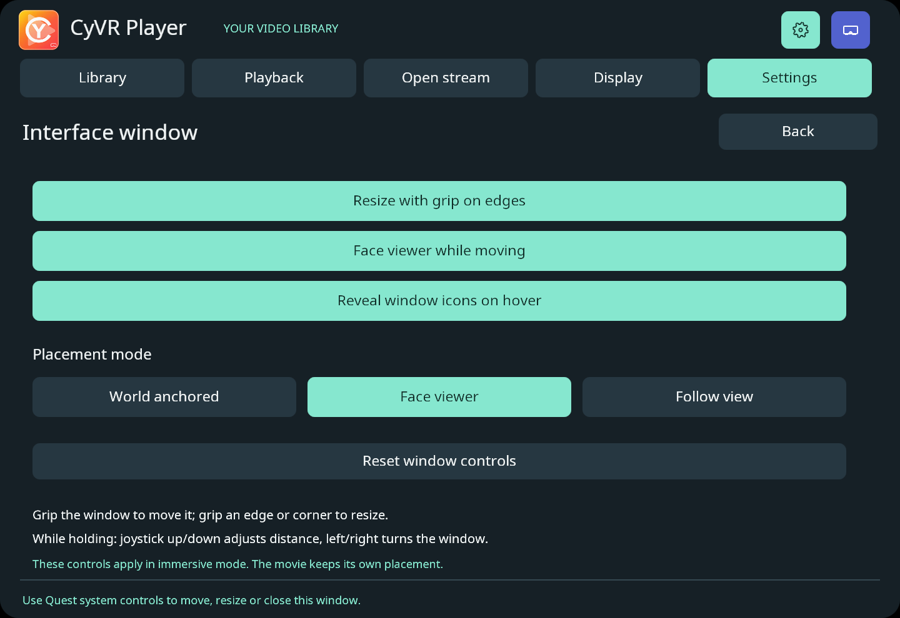
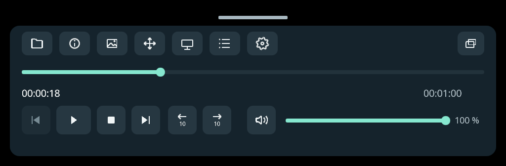

<p align="center">
  
</p>

# CyVR Player

A native C++17 / Vulkan video player for Meta Quest, using the local [CyVR_UI foundation](https://github.com/MrMybal/CyVR_UI). Beta version: **0.4.15-beta.1**.

The app opens in a **real Android 2D window**, without creating an OpenXR instance or session. Horizon OS owns moving, resizing and closing the window, including multitasking. **Enter immersive** explicitly opens the optional VR host for cinema, stereoscopic and panoramic playback. **Return to 2D** or Android Back restores the panel. Both hosts use the same C++ interface, themes, English/French translations, browser and player model. The current integration uses **CyVR_UI 0.9.1**, with static GPU scene buffers and its original PBR materials/offline lighting. These scene resources are excluded from strictly 2D builds.

## Screenshots

The shared C++/Vulkan interface, captured with the desktop inspector using demo media and folders. Click a screenshot to view it at full size.

| Library and video previews | Playback and timeline |
| :---: | :---: |
| [](docs/images/library.png) | [](docs/images/playback.png) |
| **Real-time image quality** | **Immersive cinema settings** |
| [](docs/images/image-quality.png) | [](docs/images/cinema.png) |
| **Subtitle appearance** | **Interface window settings** |
| [](docs/images/subtitles.png) | [](docs/images/window-controls.png) |

The compact immersive playback bar, shown on its own:

[](docs/images/compact-controls.png)

Capture details and demo image credits: [screenshots](docs/images/README.md).

## Build

CyVR_UI 0.9.1 window controls are integrated in immersion: grip anywhere on the full interface to move it, or grip an edge/corner to resize it. While holding, the joystick adjusts distance and yaw. The small bar below the window reveals placement, minimize and close icons on hover. **Settings → Interface window** controls these options. The film retains its independent spatial placement, and the compact playback bar keeps its trigger drag handle.

The branding resource step requires Pillow (`python -m pip install Pillow`) at build time. The runtime remains native C++/Vulkan.

From PowerShell in this folder:

```powershell
python tools/prepare_splats.py
python tools/build_codecs.py
python tools/build_subtitles.py --target windows
python tools/build_subtitles.py --target android
python tools/build_discs.py --target windows
python tools/build_discs.py --target android
python tools/build_ffmpeg_android.py
python tools/build_app.py --target all
python tools/build_app.py --target android --no-immersive
```

The final command builds an alternative 2D-only APK with `CYVR_ENABLE_IMMERSIVE=OFF` and `AndroidAppConfig::immersiveEnabled=false`, without the OpenXR loader, XR runtime queries or immersive activity.

| Output | Purpose |
| --- | --- |
| `dist/android/CyVR_Player-debug.apk` | Native 2D launcher with optional immersive video |
| `dist/android/CyVR_Player-panel-debug.apk` | Exclusively 2D alternative |
| `dist/windows/CyVR_Player.exe` | Vulkan UI inspector and media inspection; hardware playback runs on Quest |

Both APK variants keep `com.cyvr.player` and the existing development signing key, so `adb install -r` preserves app files and grants. They replace one another. Android API 32 and Horizon OS v69 or later are required. These are development builds, not store release packages.

For the Android Beta package, run `python tools/prepare_splats.py`, `python tools/build_codecs.py`, `python tools/build_subtitles.py --target android`, `python tools/build_discs.py --target android`, `python tools/build_ffmpeg_android.py --alpha`, then `python tools/build_app.py --target android --beta`. This separate Release profile produces `dist/android/CyVR_Player-0.4.15-beta.1-arm64.apk`, disables Android debugging, and retains the existing development signing identity for upgrades. Beta builds are for testing, not store submission. Use `python tools/verify_app.py --beta` to validate the package. The Beta uses the same expanded media dependency profile prepared with `build_ffmpeg_android.py --alpha`. Run `python tools/package_release.py` after staging the source changes to package it. Release assets include the exact source snapshot of the player and its local MIT-licensed CyVR_UI foundation, dependency sources and build instructions. `CYVR_UI_ROOT` can select that supplied foundation when rebuilding.

Prerequisites are the existing Android SDK (NDK 27.2.12479018, CMake 3.22.1, Build Tools 35.0.1, platform 34), JDK, LLVM/Windows C++ SDK, and the sibling `../CyVR_UI` checkout. `ANDROID_HOME`, `JAVA_HOME` and `CXX` can override tool locations. `CYVR_UI_ROOT` is the corresponding CMake setting. The local foundation includes the small reusable GPU/lifecycle extension hooks described in [the integration notes](docs/interface.md); retain those local changes when updating it.

For a fresh dependency cache:

```powershell
python tools/fetch_ffmpeg.py
python tools/prepare_android_media.py
python tools/build_ffmpeg_android.py
```

## Use and quality

Open **CyVR Player** from Home or Overlay. Browse the app's own external folder, use **Open a folder** for Android SAF access, or enter an HTTP(S), HLS or RTSP address in **Open stream**. Android VIEW intents are also supported. Display settings select mono, SBS or top/bottom, half-width/height packing, eye inversion and flat/180°/360° projection. Panoramic presentation requires immersion.

**Display → Video format → Auto-detection: On/Off** controls automatic layout detection. It is **off by default**, including when migrating old checkpoints. With detection off, opening or inspecting another file retains the selected eye layout, projection, half packing and eye order. The preference survives activity changes and restart. **Detect once** applies the available metadata/name hints to the current media without enabling the preference.

With automatic detection explicitly enabled, container **StereoMode / st3d** and **spherical projection** metadata take precedence over filename hints such as `_180_LR`, `_360_TB`, `HSBS`, `FSBS`, `HOU`, `3DH` and `3DV`. Filename hints also work for streams and SAF documents. A manual choice still overrides detection for the current file; the next open follows the saved preference. Ordinary or unlabelled files use flat 2D in automatic mode; aspect ratio alone does not classify a film as VR. Half/full packing uses supported hints and sample aspect ratio. Actual decoded MVC/MV-HEVC views retain their required full-width SBS transport. Unsupported projections remain manual; cubemap/fisheye rendering and image-content analysis are not added.

In **VR180**, zoom ranges from **0.25× to 4×**, available through Zoom −/+, the image slider, right stick and grip + trigger hand movement. **Fit image** restores 1× and centres the image. Zoom below 1× reduces the angular picture size; uncovered areas reveal the environment instead of stretching edge pixels. Eye separation and coverage are preserved through Native/CAS/FSR/GSR. Cinema and 360° retain their existing 1×–4× range; leaving VR180 clamps smaller zoom values back to 1×.

In immersion, opening a video starts with a compact seek bar, play/pause, previous/next file and **Full interface**. Only the compact controls hide after **three seconds** without interaction. The full interface and minimized full window stay available while adjusting settings. A deliberate button/trigger press or tracked-hand pinch restores the compact bar; ordinary controller movement and light trigger contact do not wake it. The first waking gesture is consumed. The full interface's **Close** button returns to compact playback. **Minimize** collapses the full window while keeping its dock available for restoring it. The compact bar has a small drag handle above it; moving it leaves the movie anchored. Previous/next uses the current folder playlist and does not wrap at its ends.

The **Playback** page separates transport and volume into one bottom strip, with tracks, subtitle settings and placement in a right-hand column. In immersion, the header **Close full interface** cross beside **Return to 2D** returns to compact playback without interrupting the film. **Minimize** keeps its separate window-minimizing behavior. The compact bar auto-hides after three seconds. A deliberate button press restores it; ordinary movement does not. **F11** remains available for video-only viewing with a physical keyboard. In 2D, Quest system controls manage the window.

In immersion, the video has its own scene placement. You can move and release the controls panel to either side without moving or rotating the cinema screen or panorama. This applies to Native, CAS, FSR and GSR, including paused/video-only viewing. **Display → Video format → Recenter video** places the video in front of your current view and leaves the controls panel in place. Video zoom and position controls remain available. Placement is retained within the current immersive host; a new immersive session starts with a new placement. Initial tracking fallback may be head-relative until a valid local pose is available.

**Display → Immersive cinema** (also **Cinema** on the compact bar) provides three pages:

- **Screen geometry:** width and distance (1–12 m), curvature (0–120°), vertical offset (±3 m), tilt (±90°), roll (±180°), and flat/curved/large/reset presets. The front centre stays anchored when curvature changes. Native video uses a cylinder compositor layer when supported; filtered video uses the same geometry in its per-eye projection. The native layer keeps its decoded dimensions. Curved captions use matching cylinder geometry.
- **Environment:** black cinema (default), dark background, two 4K CC0 environment photographs, three modeled rooms, and passthrough when supported. Brightness affects the rendered environment, independently of movie brightness; passthrough exposure remains managed by the headset. Interface opacity is separate. Missing passthrough falls back to dark with a message.
- **Ambilight:** enable an optional soft colour halo around the screen. Intensity (0–200%), spread (5–60% of screen width per side), smoothing (0–1.5 s), saturation (0–2), automatic black-bar exclusion and manual edge inset are adjustable. Reset returns the effect to its disabled default. Lower smoothing follows cuts faster; higher smoothing makes transitions gentler. Black-bar detection can be disabled for very dark scenes.

Ambilight follows the movie's position, zoom and flat/curved geometry. It averages stereo eye colours in linear light and uses a floating-point history. A tiny 64 × 36 GPU capture supplies a 128 × 128 halo, updated at most 30 times per second; it does not downscale the movie or copy video pixels to the CPU. No extra capture or glow draws occur while disabled. It is a composited screen surround effect, without room-light/shadow simulation. Native/CAS/FSR/GSR remain available. Screen geometry and Ambilight apply to cinema video; panoramic and Gaussian content retain their projections. These preferences are retained across activity changes and upgrades, and can also be prepared from the 2D host.

The **Playback timeline** shows the current position and total duration. Click or drag the thumb to select a time; the displayed time previews the selection while dragging, and one seek is committed on release. Playback keeps its previous play/pause state. Losing focus, hiding controls or cancelling the gesture discards the unfinished selection. Live/unseekable sources and sources without a known duration show a disabled track. The native decoder retains the final preroll frame when a seek reaches the end, so the last available picture can still be presented.

In **Native** mode video stays at its **decoded source dimensions** through the MediaCodec → PRIVATE AImageReader → AHardwareBuffer → Vulkan path; pixels are not copied through the CPU. VR uses dedicated native-size compositor video layers. The 2D preview fits the window while retaining its full-size source texture. Enhancement reconstructs the displayed window or eye view; it never reduces decoder resolution. The panel renders at the Android surface size. Immersive scene targets use the runtime's recommended resolution, with no former 1024-pixel reference cap. This does not promise a one-to-one mapping to physical display pixels through the headset optics, or recover detail absent from a source.

Container track selections, external subtitle URI, navigation, document URI, URL draft, stereo/projection settings, playback position, image corrections, filter, scale and zoom settings, and pause state are saved in private app storage across activity replacement and process restart. Shared CyVR_UI preferences preserve language and theme. Existing SAF grants and app files are retained.

## Browser and placement controls

The library offers **Tiles** (the initial view) and **List**, both with continuous scrolling and previews. Point the controller ray inside the file grid/list, then push that controller's joystick up/down to scroll. A light resting trigger contact does not block scrolling. The cursor keeps hovering the current file while scrolling; holding a selected file or dragging the scrollbar suspends joystick scrolling. A draggable vertical scrollbar also works with a controller ray, mouse or touch. File pagination is removed; only the visible rows are drawn and at most nine thumbnails are requested at once. Browser input does not seek or zoom a playing movie. The selected view and scroll position survive activity changes and restart. The left sidebar switches between granted **Locations** and saved **Favorites**. **Open a folder** opens Android's folder chooser, retaining its read grant and other previously granted locations. Select the star to add/remove the current folder from up to 16 favorites. Favorites retain their known parent navigation; opening a different location starts its own navigation. These controls work in the 2D and immersive hosts. Android's storage restrictions still apply; the player does not bypass protected application directories. Folder listings are bounded to 10,000 entries.

Previews remain visible while a video plays. A failed preview is retried instead of stored as a permanent empty cache entry. Android provider thumbnails and scaled frame extraction are preferred; a single background FFmpeg worker supplies a bounded fallback for sources up to 64 megapixels, including 8K. The provider request has a cancellation deadline; unsupported or unavailable files can still retain a placeholder. **Refresh** renews thumbnails. The runtime never downloads stream URLs for automatic previews.

**Display → Video placement** controls cinema translation (±10 m) and yaw/pitch/roll (±180°). Panorama VR180/360 is rendered at infinity, so its page offers rotation and existing Zoom instead of ineffective translation controls. **Place in front of me** centers the video using the current headset pitch/roll as well as yaw, including reclining viewing. **Reset placement** clears manual offsets and legacy cinema tilt/elevation. These controls do not reposition the UI.

Point at the visible movie outside the controls and hold a controller **trigger** to grab it. Moving the hand translates the cinema screen; turning the wrist rotates it. Release keeps that pose, including its six-axis placement settings. The full panel, compact toolbar, dock and file grid keep priority over movie grabs. A wake-up press only reveals hidden controls; release before grabbing. **Grip + trigger** retains the existing zoom gesture. Either joystick's **left/right** axis turns the movie view at up to 60 degrees/second around the viewer. The right stick's **up/down** axis zooms outside the UI. These deliberate stick adjustments remain usable with hidden controls and do not reveal them. Seeking remains available on the timeline and transport buttons.

VR180/360 content is at infinity: grabbing rotates its view, while translation applies to cinema screens. Flat and curved cinema use the same geometry for hit testing and rendering. Hand grabs cancel on tracking loss, focus loss, media changes or a tracking-origin change, requiring release before another grab. Known origin changes retain movie placement through the existing room-space rebasing; an unknown runtime transform still requires manual adjustment.

**Keep placement on recenter** is on by default and prefers OpenXR's STAGE reference space when available. Known origin changes are rebased at their effective time; switching reference spaces preserves the movie pose. LOCAL remains a fallback. An unknown tracking-origin transform cannot guarantee physical continuity and produces a placement message. Settings persist across host changes; the actual tracking-space anchor is created for each new immersive session. See [OpenXR reference spaces](https://registry.khronos.org/OpenXR/specs/1.0/man/html/XrReferenceSpaceType.html).

Compact controls include icons for the library, movie information, image filters, placement, cinema, tracks, settings and full interface, alongside transport and volume. Hovering an icon shows its action name. The larger interface retains text on format and cinema choices. **Settings** contains language, theme and player-local volume. Volume ranges from mute to unity gain; short callback ramps avoid abrupt changes and do not alter the media clock. Muting survives new decoders and host changes. The default language remains English, with French available.

## Web browser

**Open stream → Web browser** opens a resizable 2D window on the system WebView (from the 2D host only). It runs in its own process, so a failing page cannot stop the player, and sites play inside the page, including YouTube and its fullscreen mode. The toolbar blocks requests to a built-in list of advertising and tracking domains, and shows a count; the same button turns this off.

**Play in CyVR** appears when a page requests a direct `.mp4`, `.webm`, `.mkv`, `.mov` or `.m3u8` video, and opens it in the player with its `Referer`, user agent and cookies. These stay in memory and are never saved. Cookies are scoped to the video's host, so a playlist cannot send them elsewhere.

Blocking by domain does not remove ads served from a site's own video host, such as YouTube's in-stream ads, or empty spaces left in pages. YouTube and similar sites deliver adaptive streams that are not plain files, so they play in the page and offer no **Play in CyVR** button. DRM-protected services cannot reach the player; see [Scope limits](#scope-limits). Google sign-in may refuse embedded browsers. Pages have no access to files, the camera or the microphone, and cannot launch other applications.

## Audio playback

Audio is decoded by FFmpeg and converted to interleaved 48 kHz stereo for AAudio. Surround downmix coefficients are normalized, with 1 dB of additional headroom for codec/resampling overshoot; stereo keeps unity gain. A finite/full-scale safety check protects the native output. This is stereo playback, without head-tracked spatial-audio rendering.

The worker prebuffers 120 ms before starting audio and reads ahead toward 250 ms even when the decoded video queue is full. Compressed lookahead is bounded to 64 MiB / 2,048 packets. Rounded MKV timestamps do not splice continuous samples; real discontinuities over 100 ms retain their timing. An unexpected starvation inserts silence without discarding late PCM or falsely advancing the media clock. The AAudio buffer uses native burst sizes and grows after reported system underruns. Diagnostic counters distinguish missing PCM, intentional gaps, discarded samples, overrange/invalid samples and device underruns.

`python tests/audio_integration.py` compares generated stereo/5.1/7.1 files with FFmpeg references. `python tests/quest_audio.py --serial DEVICE` exercises those original fixtures on a connected Quest, including a deliberately chunked MKV, hardware/software video paths and pause/seek/resume. These checks cannot replace listening to the headset speakers or connected headphones.

## Image controls and previews

The library shows **static 160 x 90 video thumbnails** from one background worker. It requests the visible seven list rows or six cards, retains at most 32 successful previews, retries transient failures and cancels obsolete requests. Android provider thumbnails and scaled extraction are preferred, with a one-thread FFmpeg fallback. Previews remain available during playback. Local files and authorized SAF descriptors are supported; stream URLs are not fetched automatically. Unsupported or over-budget files keep a type placeholder. No continuous animated preview is decoded.

**Display → Image corrections** provides exposure (−2 to +2 EV), contrast, saturation, gamma, zoom (1–4x), and horizontal/vertical position. Reset restores neutral values. In 2D, zoom crops within the video, preserving the aspect ratio and eye boundaries. In immersive flat cinema, zoom enlarges the physical screen while retaining the complete picture; position moves that screen. Panorama zoom is a digital per-eye crop. Changes also redraw an already-paused frame without resuming decoding.

Controls remain available through the on-screen sliders/buttons. In immersion, either **thumbstick left/right** turns the movie view outside the controls; the **right thumbstick up/down** adjusts zoom. While pointing inside the library, **up/down** scrolls files. Hold **grip + trigger**, then move the hand up/down to zoom directly. When hidden, the first press only restores controls; release and press again to zoom. A trigger alone still restores hidden controls. On a physical keyboard, left/right seek ±10 seconds and up/down zoom; the first key restores hidden controls. The Windows inspector also accepts the mouse wheel for zoom.

**Display → Image quality** offers:

| Mode | Processing | Output |
| --- | --- | --- |
| Native (default) | Hardware YCbCr conversion, optional corrections in the same pass | Source dimensions |
| FidelityFX CAS | AMD contrast-adaptive sharpening in linear RGB | Display target |
| FSR 1 | AMD EASU followed by RCAS, in perceptual RGB | Display target |
| Snapdragon GSR 1 | Qualcomm spatial upscaling/sharpening in one filter pass, perceptual RGB | Display target |

Filters affect **only the video**, so the native UI stays sharp. SBS/TB taps clamp within each eye. Sharpening strength is adjustable. FSR/GSR are spatial filters; they do not invent missing source detail or generate frames. GSR 2/FSR 2 are not used because the decoded video path does not provide their required scene depth and motion data. GSR 1 is pinned from [the upstream project](https://github.com/SnapdragonGameStudios/snapdragon-gsr/tree/d926f074bcb9d714e179f1ce0fcb9ee2eeb5074e/sgsr/v1), with BSD-3-Clause notices packaged.

**Image smoothing** offers Original (the existing fastest sampling), Bilinear (4 taps) and bounded Catmull–Rom Bicubic (16 taps). **Noise reduction** and **Fine detail** have independent 0–100% controls; they share a 3×3 source neighborhood. The noise filter reduces small spatial differences while retaining stronger edges. Fine detail adds bounded local contrast, suppressing the small residuals targeted by noise reduction. These controls apply in Native mode and before CAS/FSR/GSR, before HDR transfer/tone mapping, and also redraw paused pictures. They process the displayed window or current eye view rather than a complete enlarged panorama. They apply to ordinary/stereo/panoramic video; Gaussian scenes retain their existing renderer. These are spatial filters, without temporal denoising or AI detail recovery. Higher settings add GPU work and can soften fine texture or emphasize compression artifacts. Original sampling, zero noise reduction and zero detail are the defaults. **Disable spatial filters** restores those three values while retaining the chosen upscaler, zoom and color corrections. **Reset image** resets all image settings. Preferences survive activity changes and upgrades.

The default native path, with the optional spatial filters disabled, keeps the complete decoded source in one conversion/correction pass. Enhancement first projects **only the displayed picture**: the fitted image in 2D, or the current predicted field of view for each eye in VR180/360. Immersive cinema screens, flat or curved, are filtered once per decoded video frame at the screen's display density and handed to a world-locked compositor layer, so head movement causes no filter work. Sources above that density keep their detail up to twice the density, or 1.25x above 40 fps. CAS sharpens at the output resolution. FSR/GSR reconstruct from the available source detail in that view (including zoom); their input never exceeds the output. Each axis retains its available detail independently, including half-width/height stereo; the projection FOV and UV mapping preserve geometry even when the intermediate has a different aspect ratio. The output defaults to **Headset / window**, meaning the runtime's recommended eye resolution or actual window picture size. Optional 1.25x, 1.5x and 2x choices multiply that display target. All controls remain available, including with large panoramas. The previous fixed 16-megapixel filter cap is removed. A Vulkan limit/allocation failure preserves the requested settings, reports an error, and temporarily uses native rendering until a filter/scale request retries it.

Conversion/projection and all filter passes share one command buffer, one queue submission and one completion wait: per decoded frame on cinema screens, per eye and display frame in VR180/360. CAS/GSR need one RGB input; FSR additionally needs an EASU intermediate. Hardware video playback does not read pixels through the CPU; explicit software fallback does. There is no claim of sustained 4K/8K or thermal performance without headset measurements.

On **Playback → Performance**, the HUD separates the file's nominal frame rate, distinct video frames processed by the GPU, usable decoder output, app frame submissions and the XR runtime's reported refresh rate. Repeated VR redraws do not inflate the video count. It also shows late drops, queued frames, rendering errors, GPU video mean/p95 and CPU work including waits. GPU timings use Vulkan timestamps when supported, cover video conversion/projection/filter passes (summed across both VR eyes), and exclude Ambilight, UI, compositor and decoding. Separate technical Ambilight logs report capture and halo GPU times. Unknown measurements remain **Not measured**. Event rates age out when stalled, and pause/seek clears old cadence history. These measurements do **not** measure frames actually displayed by the Quest compositor.

See [processing details and limits](docs/image-processing.md).

## Containers, audio and subtitles

**Playback → Tracks, subtitles and chapters** lists container video, audio and subtitle tracks, including codec, language, title, default/forced flags, and chapters. Selecting a track reopens the same document at the current time and preserves play/pause. The selection survives activity changes and restart. Track changes currently require a seekable source. Audio and subtitles can be disabled independently. Select an external subtitle file in the library after opening a video.

The Android profile enables FFmpeg's built-in LGPL-compatible demuxers, parsers and decoders, including Matroska compression through zlib. Video uses MediaCodec when the device reports support (AVC/HEVC/VP8/VP9/AV1/MPEG-2/MPEG-4/H.263); configuration failure falls back to FFmpeg software decoding. A later hardware failure retries through software on seekable sources. Software video uses a four-buffer AHB pool; ten-bit input retains ten-bit RGB precision. This path copies/converts pixels on the CPU and can be substantially slower.

Audio is decoded with FFmpeg, resampled/downmixed to stereo float and sent to AAudio. Video follows the audio presentation clock when present. Audio buffers are bounded; the callback allocates nothing and uses silence for timestamp gaps. Seek recreates the timeline and decoders. Unsupported audio/subtitle initialization leaves video usable and reports the track error in the tracks panel.

Text subtitles use **libass + FreeType + HarfBuzz + FriBidi**, including ASS/SSA styling, positioning, animation and embedded font attachments. SRT and WebVTT are converted by FFmpeg. FFmpeg bitmap subtitle decoders feed the same overlay (including PGS/DVD/DVB when decodable). In VR, captions have a separate video-anchored compositor layer; hiding or moving the controls does not hide or move them. In 2D they overlay the fitted video. External subtitle files are limited to 16 MiB and queued events to 64 MiB. Local IDX/VobSub pairs need their companion file; SAF descriptors cannot resolve arbitrary companion paths.

HDR10/PQ and HLG are converted in Vulkan from BT.2020 to the SDR sRGB display path, before image corrections and reconstruction. The tone mapper uses available mastering peak metadata (default 1,000 nits). This is tone mapping to SDR, not native HDR panel output or Dolby Vision/HDR10+ dynamic-metadata processing.

## Subtitle appearance and placement

**Settings → Subtitle settings**, or **Playback → Tracks → Subtitles → Subtitle settings**, offers text size, opacity, outline, shadow, six text colors, bold, italic and an optional background. Source styling is retained by default; editing colors/attributes enables the custom dialogue style. ASS signs and explicitly positioned text may retain their authored overrides. Image subtitles retain their original palette.

Horizontal/vertical offsets and size also apply to bitmap subtitles. VR captions can follow movie depth or use an independent distance while retaining angular size and screen curvature. Settings affect paused captions and persist across hosts/restart. Reset restores source styling and movie depth. The Return to 2D control uses a distinct color to mark a presentation-mode change.

## DVD and Blu-ray ISO images

Open a `.iso` or `.img` file in the library or through Android's document picker. The reader detects **DVD-Video** or **Blu-ray**, reads directly from the image without mounting or extracting it, and automatically selects the longest supported movie title. **Playback → Tracks → Disc titles** selects another title; a title change starts it at zero and preserves pause. Track changes within a title preserve the position. Title/angle choices, tracks and navigation survive activity replacement. Existing flat/curved cinema, hidden controls and image corrections remain available.

DVD IFO program/cell order, chapter points, aspect ratio, audio/subpicture language mappings and subtitle palettes feed the existing playback pipeline. Blu-ray MPLS/CLPI playlists supply clip order, duration, chapters, angles and stream languages. Clip/cell timestamps become one continuous movie clock, including source timestamp resets between segments. Seeking aligns to disc access units; a leading partial audio frame is discarded after a seek. DVD MPEG-2 and Blu-ray AVC/HEVC use the existing hardware decoder/fallback selection.

The pinned readers are **libdvdread 7.1.1** (GPL-2.0-or-later), **libbluray 1.5.0** and **libudfread 1.2.0** (LGPL-2.1-or-later). Their sources and notices accompany the Alpha. Both local files and seekable Android SAF descriptor slices work. HTTP(S) ISO URLs need a known image size and reliable byte-range support; this is random-access disc reading, not live transport streaming. Local ISO entries use a disc placeholder rather than starting an expensive background disc scan for each browser row.

Interactive DVD/HDMV/BD-J menus, CSS/AACS/BD+ protected payloads, DVD-Audio, DVD-VR, arbitrary data-disc browsing and interleaved DVD angle/interactive program chains are not implemented. Unsupported images/titles report an error. Blu-ray 3D SSIF reconstruction is unavailable; the disc panel identifies its 2D base-view fallback. Codec, hardware and HDR limitations described elsewhere still apply, including to UHD images.

For reproducible tests, use `python tools/make_disc_fixtures.py` with FFmpeg, Pillow, tsMuxeR 2.7.0, dvdauthor/spumux 0.7.2 and mkisofs. `--dvd-tools` and `--tsmuxer` select external authoring-tool paths; these tools are not application dependencies. The fixtures contain generated color patterns, tones and a bitmap caption. Run `python tests/disc_integration.py` after a Windows build; it checks complete decode, title/chapter selection, continuous timestamps, bitmap subtitles, SAF slices, HTTP ranges, state restoration and malformed image rejection.

## MVC, spatial video and encrypted files

MVC/H.264 and two-view MV-HEVC are decoded in software, using the BSD edge264-mvc decoder and FFmpeg HEVC respectively. MVC works with interleaved Annex B/Matroska streams and MPEG-TS carrying its dependent view on a separate PID in the same program. Ambiguous programs with multiple base/dependent candidates are not automatically merged. MVC currently requires progressive 8-bit 4:2:0. MV-HEVC retains 8/10-bit samples and matches eye frames by presentation timestamp, using left/right metadata when available and view ID order otherwise. Output is full-width SBS; the application selects that layout automatically, and eye inversion remains available. Missing/unmatched eyes produce an error instead of displaying the base image in both eyes. Blu-ray 3D SSIF images currently play their 2D base view with an explicit notice. Software decoding performance depends on dimensions, profile, frame rate and device CPU capacity.

For **CENC AES-128** content for which you have keys, select a standard ClearKey **JWK Set** file (`.jwk` or `.clearkey`) in the library after opening the video. **Playback → Tracks → Video tracks → Import ClearKey (JWK)** opens the library; **Remove ClearKey** removes the selection. The player reopens the current source using the supplied KID/key mapping. Up to 16 unique 16-byte KIDs/keys are accepted, in base64url, with strict size/structure validation. Local files and explicitly granted SAF documents work; keys are not fetched from arbitrary URLs. Only the selected file URI is checkpointed across hosts, and key bytes stay in process memory. The player does not acquire licenses, extract keys, or implement Widevine/PlayReady/FairPlay. Those systems need their provider's authorization and DRM integration, which this open-source native renderer does not supply. Existing HLS AES-128 support remains available through FFmpeg.

## Gaussian Splatting

The player loads standard **Gaussian PLY** (ASCII or little-endian binary, with Gaussian scale/rotation/opacity/SH attributes) and the common **32-byte `.splat`** format. These are real volumetric scenes: the immersive renderer uses each eye's current pose, GPU visibility, stable 32-bit radix sorting and Gaussian rasterization on the same Vulkan device as CyVR_UI. The MIT backend is pinned from SplatKit; no noncommercial INRIA renderer is bundled. Native resolution and Native/CAS/FSR/GSR remain selectable. The 2D host also displays these scenes.

Animated independent frames use the explicitly internal `.splatseq` format documented in [Gaussian playback](docs/gaussian-splatting.md). Play/pause and seek share the playback controls. It is not a standardized Gaussian video codec. The current profile supports at most **1,000,000 splats/frame**, SH degrees 0–3, one decoded frame plus the frame retained by rendering, and bounded file loading. Source scenes are centered/scaled consistently from the first frame. The backend packs colour to RGBA8 and covariance/SH to half precision; native target resolution does not make this representation lossless. SPZ, SOG, compressed PLY, deformation-based 4D models, sequence soundtracks and network/SAF-relative sequence manifests are not implemented.

## Scope limits

Broad format support depends on the compiled decoder, device capabilities and the particular stream. AV1 uses the hardware decoder when available and the bundled BSD dav1d 1.5.4 decoder otherwise. MVC and MV-HEVC stereo use software decoding with full-resolution eye packing. Service DRM systems such as Widevine/PlayReady, fisheye/cubemap adapters, audio-only playback, disc menus, SMB/NFS and plain M3U/PLS playlists are not implemented. HLS/HTTP(S)/RTSP paths remain available; the Android profile does not include libxml2 for DASH or libSRT. Large/high-bitrate software decode can exceed mobile CPU capacity. There is no universal-format or sustained 8K guarantee.

## Verify

```powershell
python tests/container_integration.py
python tests/compat_integration.py
python tools/verify_dependencies.py
python tools/generate_player_locales.py --check
python tools/adapt_gsr1.py --check
python tools/verify_app.py
python tools/verify_app.py --panel-only
python tests/quest_app.py --serial QUEST_SERIAL
python tests/quest_hosts.py --serial QUEST_SERIAL
python tests/quest_gpu.py --serial QUEST_SERIAL
python tests/quest_compat.py --serial QUEST_SERIAL
python tests/quest_image.py --serial QUEST_SERIAL
python tests/quest_view.py --serial QUEST_SERIAL
```

`build_app.py --target windows` runs fourteen CTest suites, including application state transfer, malformed state handling, pointer navigation, translations, independent 24 fps video / 72 Hz redraw counting, stalls and the shared UI core. The GPU image suite covers 1,060 checks, including identical output from separate and combined submissions for CAS/FSR/GSR, the real projection shader before filtering in mono-eye/SBS/TB/cinema/180°/360°, transparent edges and preserved detail when only one axis needs upscaling. `quest_hosts.py` requires `Exemples/avc.mp4` in the app's external files folder; it uses real Android input to test resizing, resume and both presentation transitions. For the installed 2D-only variant, add `--panel-only`. Network tests remove their own adb reverse when complete. Device tests change the current document, navigation and UI settings; they do not clear app data.

See [validation and remaining measurements](docs/validation.md), [host integration](docs/interface.md), [media architecture](docs/architecture.md), [sources and streams](docs/sources-et-flux.md), [dependency review](docs/bibliotheques.md) and [Gaussian Splatting playback](docs/gaussian-splatting.md).

## License

Original CyVR Player source code, shaders, build scripts and documentation are licensed under the **GNU General Public License, version 3 only** (`GPL-3.0-only`), unless an individual file states otherwise. Copyright (C) 2026 MrMybal. See [LICENSE](LICENSE) for the full terms and [NOTICE](NOTICE) for the project notice and third-party scope. The program is provided without warranty.

Commercial use and sale are permitted. Redistributing the application, including modified versions, requires complying with GPLv3, including its corresponding-source requirements. Keeping this development repository private does not remove those obligations when binaries are distributed. The build packages the project's GPLv3 text and notice in `assets/licenses` for both Android and Windows.

Third-party components retain their own copyright notices and licenses. [CyVR_UI](https://github.com/MrMybal/CyVR_UI), CAS and FSR 1 use MIT; Snapdragon GSR uses BSD-3-Clause; dav1d uses BSD-2-Clause and edge264-mvc uses BSD-3-Clause; the Android FFmpeg build uses shared LGPL-3.0-or-later libraries with GPL/nonfree disabled; Mbed TLS uses Apache 2.0; OpenXR uses its supplied open-source license. Pinned sources/checksums are recorded in `dependencies.lock.json`; packaged notices are under `assets/licenses`. Redistribution must retain the applicable notices and satisfy the dependencies' own obligations, including FFmpeg source/relinking requirements. No proprietary media or rendering SDK was added.
