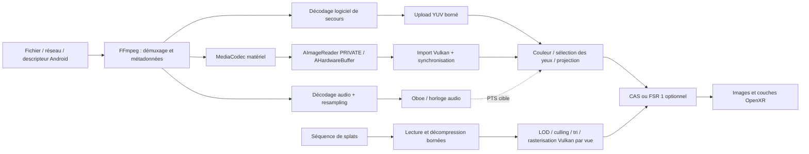

# Architecture du moteur

L'interface custom C++/Vulkan est intégrée via CyVR_UI dans la cible d'application optionnelle. Le cœur média reste indépendant des widgets. Voir [interface.md](interface.md) pour le profil effectivement raccordé. Les modules non encore présents décrivent l'architecture cible.

## Circulation des données

Sur Android, l'accès à un fichier choisi via le Storage Access Framework devra utiliser un descripteur et un AVIO FFmpeg adapté, plutôt qu'une conversion supposée de `content://` en chemin. La fermeture du descripteur appartient au module d'entrée. Réseau et démuxage doivent avoir des délais et une annulation.

## Décodage et présentation

FFmpeg produit les unités d'accès compressées. `VideoBitstream` effectue maintenant la conversion AVC/HEVC vers Annex B et prépare les données `csd-*` ; `make_video_format` les transmet à `SurfaceDecoder`. Ce chemin complet a été exécuté sur Quest 3 pour AVC et HEVC. Les adaptations AV1/VP9 et la reconfiguration dynamique restent à ajouter.

Une copie du paquet compressé vers le tampon d'entrée MediaCodec subsiste. L'objectif est d'éviter la lecture et la copie CPU des **pixels décodés**, bien plus volumineux. Le décodeur peut lui-même effectuer des opérations internes au pilote : le terme zéro copie ne doit pas devenir une garantie sur l'implémentation matérielle.

Les paquets peuvent arriver en ordre de décodage ; la file de présentation attend des images dans l'ordre croissant de PTS. `Demuxer.timestamp_us` conserve les décalages des pistes par rapport à l'origine du conteneur, y compris les valeurs négatives de préroll. Le futur worker de lecture doit établir une origine commune non négative avant entrée dans le module natif, en préservant ces décalages. Les données nécessaires aux dépendances de référence doivent être décodées même si leur présentation est abandonnée.

La vidéo et l'affichage VR ont des cadences distinctes. Par exemple, à 24 images/s dans un casque à 90 Hz, on conserve la dernière image vidéo et on actualise les poses/rendus VR à chaque cycle. L'horloge audio corrigée de la latence de sortie détermine le PTS vidéo à présenter. Les conversions entre cette horloge et `XrTime` doivent être établies explicitement ; ne pas comparer des timestamps issus de domaines différents.

`PresentationQueue` garde la dernière image dont le PTS est dû et laisse les images futures en attente. Quand la file est pleine, le producteur ralentit. Sa taille, les images acquises dans AImageReader, l'image actuellement affichée et les lectures GPU en cours doivent partager un budget cohérent. **Six slots ne permettent pas de conserver six images en file plus toutes les images en vol.** Le réglage final dépendra du réordonnancement du codec et des mesures.

Lors d'un seek, incrémenter la génération, recréer le couple décodeur/reader et vider les images non soumises. Les anciennes images déjà soumises au GPU restent vivantes jusqu'à leur fence. Le numéro de génération permet de rejeter les sorties retardées du flux précédent. Le stop du codec, la pause et la fermeture sont réalisés sur le worker, pas dans le cycle OpenXR.

## Contrat d'import Android → Vulkan

`VideoRenderer` implémente maintenant l'importeur VkImage pour le profil SDR, exécuté sur Quest 3. L'architecture conserve les contrats suivants pour ses extensions futures :

1. Examiner l'AHardwareBuffer et ses propriétés Vulkan, sans supposer NV12 ou un format RGBA. Les formats externes nécessitent une conversion YCbCr et une allocation dédiée. [Spécification Khronos](https://docs.vulkan.org/spec/latest/chapters/memory.html).
2. Négocier les extensions et leurs propriétés d'import/export : `VK_ANDROID_external_memory_android_hardware_buffer`, conversion sampler YCbCr, synchronisation `SYNC_FD` et transfert depuis la famille étrangère appropriée. Aucun chemin ne doit s'activer sur la seule présence d'un nom d'extension.
3. Importer le fence d'acquisition dans un sémaphore binaire temporaire et attendre avant le premier accès shader. En cas d'échec d'import, fermer le FD encore possédé par l'application. [Synchronisation externe Vulkan](https://docs.vulkan.org/guide/latest/extensions/external.html).
4. Appliquer les barrières, layouts et transferts de propriété requis vers et depuis `VK_QUEUE_FAMILY_FOREIGN_EXT` pour le producteur média. Le chemin de repli doit suivre les propriétés et règles réellement permises par le pilote. [Familles étrangères](https://docs.vulkan.org/refpages/latest/refpages/source/VK_EXT_queue_family_foreign.html).
5. Conserver le `ImageLease` pendant toutes les lectures GPU, ou le libérer avec un fence couvrant ces lectures. Référencer seulement l'AHardwareBuffer n'empêche pas le producteur de réécrire les pixels.
6. Mettre en cache les imports par buffer du pool et les objets de conversion compatibles, en invalidant le cache au changement de format. L'usage de VMA pour les images internes ne remplace pas les contraintes d'import des buffers externes.

Le chemin normal n'effectuera pas de `AHardwareBuffer_lock`, `glReadPixels`, conversion YUV→RGB CPU, aller-retour GPU→CPU ni `vkDeviceWaitIdle` par image. Les allocations lourdes, uploads et compilations de pipelines sont à préparer hors du thread de rendu.

## Projections et couleur

Le packing stéréo et la projection sont indépendants. Lire les métadonnées sphériques/stéréo, la rotation, le crop et le pixel aspect ratio ; prévoir ensuite une correction manuelle. Les conventions 360° publiées par Google constituent une référence pour les métadonnées, pas une preuve que tout fichier est correctement balisé. [Spatial Media](https://github.com/google/spatial-media).

Le cœur actuel couvre les coordonnées équirectangulaires avec +X à droite, +Y en haut et -Z devant, plus les rectangles mono/SBS/TB. Il n'implémente pas encore de shader de projection. Cubemap, fisheye VR180 et projections propriétaires nécessiteront des adaptateurs supplémentaires.

Transporter matrice YCbCr, primaires, plage limitée/complète, fonction de transfert, profondeur et métadonnées HDR jusqu'au rendu. Ne pas interpréter PQ/HLG comme du SDR. Un fichier HDR n'implique pas une sortie HDR native dans le casque ; prévoir une conversion vers l'espace de sortie réellement accepté. Le tone mapping et la conversion de gamut restent à implémenter.

## Post-traitements

Les trois wrappers actuels prennent une texture RGB **isolée pour un œil** et écrivent en `rgba16f`, avec des groupes de 8×8 threads. L'image source et la destination doivent être distinctes et les formats/fonctions storage vérifiés. Les wrappers ne créent pas les pipelines ni les descriptors Vulkan.

| Chemin | Domaine des couleurs | Constantes / ordre |
| --- | --- | --- |
| Sans effet | Conversion adaptée à la sortie | Option de référence et mode économie |
| CAS | RGB linéaire normalisé [0,1] | `cas_constants`, même taille, sharpness 0..1 |
| FSR 1 | RGB perceptuel normalisé [0,1] | `easu_constants` pour agrandir, barrière mémoire, puis `rcas_constants` |

CAS attend des entrées linéaires ; ses sources décrivent les artefacts en gamma ou PQ. FSR 1 attend un signal normalisé perceptuel. Les conversions et le tone mapping doivent précéder le filtre adapté ; les wrappers ne les appliquent pas. Pour RCAS, 0 stop correspond à la netteté la plus forte, 2 stops à une atténuation. [Sources CAS](https://github.com/GPUOpen-Effects/FidelityFX-CAS), [intégration FSR 1](https://github.com/GPUOpen-Effects/FidelityFX-FSR/blob/master/docs/FidelityFX-FSR-Overview-Integration.pdf).

Utiliser un sampler `CLAMP_TO_EDGE` et LOD 0 pour EASU. Ne pas laisser les voisinages de filtre traverser la frontière SBS/TB : isoler la vue avant traitement. Pour une texture sphérique traitée avant projection, traiter explicitement la couture 360° et les pôles ; les wrappers actuels conviennent d'abord aux images par œil après projection. Les côtés noir/transparents d'un écran virtuel doivent être masqués lors de la composition.

Pour une vidéo, privilégier une mise en cache des traitements qui ne dépendent pas de la pose et les recalculer uniquement à la nouvelle image. Pour les traitements après projection, recalculer selon la pose VR. Ne pas agrandir toute une sphère 8K à chaque cycle 90 Hz sans démontrer l'intérêt visuel et le coût thermique. La politique finale comparera coût source, coût par vue et qualité.

FSR 1 agrandit spatialement ; il ne recrée pas des détails absents et n'allège pas le décodage du fichier d'origine. Un agrandissement d'une image déjà décodée peut même coûter plus cher qu'un échantillonnage direct. Le gain recherché concerne surtout les étapes de rendu coûteuses exécutées à résolution réduite, notamment les splats. CAS et RCAS ne doivent pas être empilés par défaut.

Les upscalers temporels de type FSR 2/3 demandent des données supplémentaires, notamment des vecteurs de mouvement et de la profondeur. Une vidéo ordinaire ne les fournit pas comme un moteur 3D. Ils ne sont donc pas une première intégration pour les films ; une scène de splats pourrait fournir ces données après travail dédié. Aucun mécanisme d'interpolation d'images n'est activé ici.

## OpenXR et bibliothèque custom

Les objets Vulkan sont créés via [`XR_KHR_vulkan_enable2`](https://registry.khronos.org/OpenXR/specs/1.1/man/html/XR_KHR_vulkan_enable2.html). Le lecteur et CyVR_UI partagent effectivement VkDevice et la queue graphique dans l'APK.

L'APK utilise une couche quad pour l'écran plat et une couche équirectangulaire lorsqu'equirect2 est annoncé par le runtime. La soumission quad est exécutée ; le contrôle visuel stéréo et sphérique reste à effectuer. Une surface Android directe pourrait être évaluée pour l'autonomie, mais ne remplace pas l'accès Vulkan nécessaire aux filtres.
